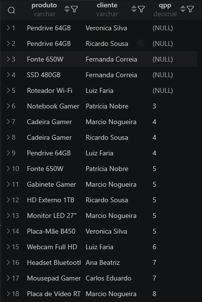

# Práticas de SQL e Análise de Dados (EBAC)

Olá, seja bem-vindo(a)!

Eu sou o **Eduardo Barcelar Cavedon**, analista de dados em formação. Este repositório documenta a minha jornada no curso de Analista de Dados da **EBAC**: cada pasta traz um projeto, com o que aprendi e as ferramentas que usei na prática.

Fique à vontade para explorar. Feedbacks e trocas de ideia são sempre bem-vindos!

> [!NOTE]
> Os módulos 1 a 12 estão em OLDER_MODULE e serão organizados em breve.

## Índice
| Módulo | Tema | Principais Tópicos |
| :--------: | ----- | -------------------- |
|[13](#módulo-13---primeiros-passos-práticos-no-sql) | Primeiros Passos Práticos no SQL | `CREATE TABLE`, `INSERT`,`SELECT`. |
| [14](#módulo-14---aprofundamento-nos-conhecimentos-intermediários) | Agrupar e Agregar | `SUM`, `AVG`, `MIN`, `MAX`, `GROUP BY`, `HAVING`. |
| [15](#módulo-15---consultas-em-múltiplas-tabelas) | Consulta em Múltiplas Tabelas | `JOIN's` & `SubQueries [SELECT], [FROM] & [WHERE/HAVING]`. |
|[16](#módulo-16---consultas-sql-avançadas)| Criação de Visualizações, Funções e Procedimentos | `CREATE VIEW`, `CREATE PROCEDURE`, `CREATE FUNCTION`.


## Módulo 13 - Primeiros Passos Práticos no SQL

Neste módulo nós vimos:

+ Criação de databases [`CREATE DATABASE`].
+ Criação de tabelas [`CREATE TABLE`].
+ Manipulação de tabelas [`ALTER TABLE`, `UPDATE`, `DROP`,`BEGIN`, `ROLLBACK`, `COMMIT`, `SQL_SAFE_UPDATES=0~1`].
+ Inserção de dados manual [`INSERT INTO`].
+ Query: Consulta simples [`SELECT`, `FROM`].

>[!TIP] 
>Resultado de uma consulta extra, que fiz ao pesquisar por conta própria (achei divertido pois foi meu primeiro contato com o `OVER`).


## Módulo 14 - Aprofundamento nos conhecimentos intermediários.

Desta vez aprendemos funções e queries bem interessantes, também ouso dizer que começou a complicar um pouquinho (mas não muito).

O que vimos dessa vez?
+ Inserção de dados [`LOAD DATA LOCAL INFILE`]
+ Query: Agregação [`SUM`, `COUNT`, `AVG`, `STDDEV`, `MIN`, `MAX`, `RANK`...].
+ Query: Agrupamento [`GROUP BY`, ` ORDER BY`, `HAVING`].

No projeto deste módulo não houve nenhuma consulta que eu considere interessante o suficiente para receber destaque aqui.

>[!IMPORTANT] 
>*Este módulo merece uma menção especial: foi nele que reorganizei as pastas e arquivos, retomei meus estudos de `Git`/`GitHub` e montei este repositório, tudo pelo terminal, hehe. Os primeiros commits ainda não seguem um padrão, mas dá para acompanhar a minha evolução no histórico.**


## Módulo 15 - Consultas em Múltiplas Tabelas

Este foi de longe o módulo mais dificil até então... Apesar de certa facilidade em lidar com os `JOIN`s por si só, tem sido difícil entender a profundidade das subqueries e todas as suas funções entre `SELECT`, `FROM` e `WHERE/HAVING`.

O que vimos neste?
+ Query: `JOIN`s [`INNER JOIN`, `LEFT JOIN`, `RIGHT JOIN`, `SELF JOIN`, `FULL JOIN`...].
+ Query: SubQuery [`SELECT`, `FROM`, `WHERE/HAVING`].

> Por incrível que pareça, a consulta mais robusta e complexa que escrevi não faz parte do Projeto Finalizador, e sim dos meus estudos pessoais de **subquery**. Faço questão de trazê-la aqui em destaque: ela usa uma CTE e uma função de janela para encontrar, para cada produto, o cliente que mais o comprou.

```sql
-- CTE para somatória e função de janela:
-- cpc = compras_por_cliente.
-- qtp = quantidade_total_produto.
-- mqp = maior_quantidade_produto.

WITH cpc AS (
    SELECT
        c.nome AS cliente,
        pd.nome_produto AS produto,
        SUM(pe.quantidade) AS qtp,
        MAX(SUM(pe.quantidade)) OVER(PARTITION BY pd.nome_produto) AS mqp
    FROM pedidos AS pe
    LEFT JOIN produtos AS pd
        ON pd.id_produto = pe.id_produto
    LEFT JOIN clientes AS c
        ON c.id_cliente = pe.id_cliente
    GROUP BY cliente, produto
)
-- Consulta a CTE e trás as colunas desejadas.
SELECT
    produto,
    cliente,
    qtp
FROM cpc
WHERE qtp = mqp
OR qtp IS NULL
ORDER BY qtp;
```




## Módulo 16 - Consultas SQL Avançadas

Este módulo foi bem intenso: aprendemos diversos comandos e técnicas de nível avançado, um atrás do outro. Confesso que tive dificuldade para acompanhar o ritmo, e isso me mostrou a importância de seguir estudando esses conteúdos de forma contínua. São conhecimentos extremamente úteis, e sempre há o que aprimorar.

O que tivemos de novo neste?
+ Alternar Delimitadores - [`DELIMITER //`, `DELIMITER ;`] 
+ Visualizações - [`CREATE VIEW`, `SELECT` * `FROM` `VIEW`]
+ Funções - [`CREATE FUNCTION`,`SELECT` column1, `FUNCTION` `FROM` table]
+ Procedimentos - [`CREATE PROCEDURE`, `CALL`, `FUNCTION(INPUT)`]