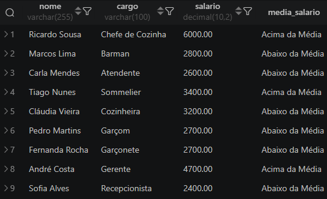

**Esse é o meu save-point dos projetos do curso de 'Análise de Dados' da EBAC.**

*OLDER_MODULE -> Módulos Inicias (por motivos pessoais eu tive que estagnar meu progresso e retornei posteriormente de onde parei, em breve retornarei nestes módulos introdutórios e atualizarei este bloco).*

**Módulo 13 - Primeiros Passos Práticos no SQL.**

Neste módulo nós vimos:

*- 1. Criação de tabelas.*
*- 2. Inserção de dados [Manualmente].*
*- 3. Query: Consulta simples [SELECT].*

> Resultado de uma consulta extra, que fiz ao pesquisar por conta própria (achei divertido pois foi meu primeiro contato com o [OVER()]).



=====================================================================================

**Módulo 14 - Aprofundamento nos conhecimentos intermediários.**

Desta vez nós aprendemos algumas funções e queries bem interessantes, também ouso dizer que começou a complicar um pouquinho (não muito).

*- 1. Inserção de dados [Archive_Load].*
*- 2. Query: Agregação [SUM, COUNT, AVG, STDDEV, MIN, MAX, RANK...].*
*- 3. Query: Agrupamento [GROUP BY, ORDER BY, HAVING].*

No projeto deste módulo não houve nenhuma consulta que eu considere interessante o suficiente para receber destaque aqui.

*"À este módulo eu deixo uma menção especial, pois foi nele que eu decidir reorganizar as pastas e arquivos, e foi onde eu retomei meus estudos de git/github e montei este repositório (totalmente pelo terminal hehe). Por isso há uma falta de padronização inicial nos commits, mas aos poucos eu fui ajustando."*

=====================================================================================

Módulo 15 - Consultas em Múltiplas Tabelas

Este foi, de longe o módulo mais dificil até então... Apesar de certa facilidade em lidar com os JOINs por si só, tem sido dificil entender a profundidade das subqueries e todas as suas funções entre [SELECT], [FROM] e [WHERE/HAVING].

*- 1. Query: JOINs [Inner JOIN, Left JOIN, Right JOIN, Self JOIN, Full JOIN...].*
*- 2. Query: SubQuery [SELECT, FROM, WHERE/HAVING].*

> Por incrível que pareça, a consulta mais robusta e complexa que eu fiz, não fazia parte do Projeto Finalizador, sendo uma consulta presente dentro dos meus estudos de SubQuery. Inclusive, faço questão de trazer a própria Query, em destaque aqui:

```sql
WITH mqp AS (
    SELECT
        c.nome AS cliente,
        pd.nome_produto AS produto,
        SUM(pe.quantidade) AS qpp,
        MAX(SUM(pe.quantidade)) OVER(PARTITION BY pd.nome_produto) AS mqtd
    FROM pedidos AS pe
    LEFT JOIN produtos AS pd
        ON pd.id_produto = pe.id_produto
    LEFT JOIN clientes AS c
        ON c.id_cliente = pe.id_cliente
    GROUP BY cliente, produto
    ORDER BY mqtd
)
SELECT
    produto,
    cliente,
    qpp
FROM mqp
WHERE qpp = mqtd
OR qpp IS NULL
ORDER BY qpp;**
```


